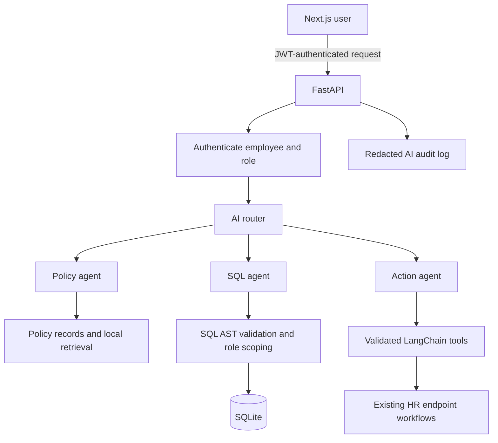

# HRMS and HR Copilot

CB Nest is a learning HR management system with an AI copilot built on top of its existing HR workflows. The copilot answers policy questions, runs guarded HR analytics, and helps employees complete leave and ticket workflows.

## What is included

- HR workflows for employees, attendance, leave, payroll, documents, policies, projects, tickets, announcements, polls, and team calendar.
- A Next.js Copilot chat at `/copilot` with one input for policy questions, HR data questions, and HR actions.
- A FastAPI router that dispatches to the policy, SQL, or action agent.
- Policy retrieval with local TF-IDF ranking and source citations. It does not use a hosted vector database.
- Read-only SQL generation constrained by approved tables and columns, role-based row scoping, SQLite query-only mode, and a 100-row limit.
- LangChain tool calling for self-service leave balance, leave requests, leave submission, ticket creation, and authorized leave approval.
- Redacted AI audit records visible to admins.

## Architecture



Identity and permissions come from the backend JWT dependency. The model does not decide a user's role or receive unrestricted database access. The router sends at most eight recent messages supplied by the browser; chat transcripts are not persisted as server-side sessions.

## Run locally with Docker

Prerequisites: Docker Desktop or Docker Engine with Compose v2, and a Groq API key for live AI responses.

From the repository root (`HRMS-main`):

```sh
test -f backend/.env || cp backend/.env.example backend/.env
```

Edit `backend/.env` and set:

- `JWT_SECRET_KEY` to a unique random value of at least 32 characters. For example, run `openssl rand -hex 32` and copy the output into the file.
- `SEED_PASSWORD` to a unique value of at least 16 characters before creating a fresh demo database. All accounts created by that seed run share this password.
- `GROQ_API_KEY` to your provider key to enable Copilot model calls.

Start the API and frontend together, and apply pending migrations:

```sh
./scripts/run-dev.sh
```

The launcher checks Docker, Compose, and `backend/.env`. If Docker is stopped, it opens Docker Desktop on macOS or starts the Docker Engine service on Linux (which may request your `sudo` password), then waits up to three minutes for the daemon. It builds both images, applies pending migrations, and runs the services in the foreground. Press `Ctrl+C` to stop them. It never seeds or resets the database. Keep the populated local demo database intact for the course demo. For a new, disposable database only, set `SEED_PASSWORD` and run `docker compose exec api python scripts/seed.py` from a second terminal while the services are running; seeding deletes and recreates sample HR records and is disabled outside development/test.

Open the app at <http://localhost:3000>. API docs are at <http://localhost:8000/docs>. Check the backend with:

```sh
curl http://127.0.0.1:8000/api/v1/health
docker compose ps
```

Demo login emails are `admin@mock-hrms.dev`, `manager@mock-hrms.dev`, and `employee@mock-hrms.dev`. Use the password already associated with the existing database; changing `SEED_PASSWORD` does not change existing account passwords. The login form intentionally does not prefill credentials. Freshly seeded accounts use the configured `SEED_PASSWORD`.

Both Compose ports are bound to localhost. The supplied Compose file, reload server, SQLite database, and browser authentication are for local development/demo use, not a public production deployment.

## Run checks

Backend tests (from `backend/`, with project dependencies installed):

```sh
python -m unittest discover -s tests -v
```

Frontend build (from `frontend/`):

```sh
npm ci
npm run build
```

Dependency scans (from `backend/` and `frontend/` respectively):

```sh
uv tool run --from pip-audit pip-audit --disable-pip --require-hashes -r requirements.lock
npm audit
```

After changing backend dependency constraints, regenerate the hashed Python 3.12 deployment lock from `backend/` with `uv pip compile --python-version 3.12 --generate-hashes requirements.txt --output-file requirements.lock`. The backend Docker build verifies hashes while installing the lockfile.

See [`docs/evaluation/report.md`](docs/evaluation/report.md) for the offline evaluation and [`docs/security/project_review.md`](docs/security/project_review.md) for the current security and requirements review.

## API routes

All endpoints are under `/api/v1`:

| Route | Purpose |
|---|---|
| `POST /auth/login` | Login and return access/refresh tokens |
| `POST /chat/test` | Check model-provider connectivity |
| `POST /chat/policy` | Ask a policy question directly |
| `POST /chat/sql` | Ask a guarded HR data question directly |
| `POST /chat/action` | Request a supported HR action directly |
| `POST /chat/router` | Route a Copilot question to a specialist agent |
| `GET /chat/audit` | List audit records (admin only) |
| `GET /health` | API/database health |

`/chat/sessions` and `/chat/sessions/{id}/messages` are contract stubs and return `501`; chat turns currently live in browser memory and are sent as bounded context with each router request.

## Role boundaries

| Capability | Employee | Manager | Admin |
|---|---:|---:|---:|
| Ask policy questions | Yes | Yes | Yes |
| SQL analytics | Own leave data only | Approved schema; employee-owned rows scoped to direct reports | Approved schema; sensitive fields excluded |
| Check own balance, view own requests, submit own leave, create own ticket | Yes | Yes | Yes |
| Approve leave | No | Direct reports only | Yes |
| View AI audit logs | No | No | Yes |

The API enforces these limits. Hiding a UI control is not treated as authorization.

## Evaluation and demo

The automated suite is offline and deterministic. It covers policy retrieval and abstention, SQL validation and row scoping, action permissions, router follow-ups, audit redaction, and security hardening. Live-provider response quality has not been scored automatically.

Use [`docs/demo_runbook.md`](docs/demo_runbook.md) for the fixed demo order and verification steps. Avoid entering real employee data into the external model provider during a demo.

## Known limitations

- Server-side conversation/session persistence is not implemented.
- Browser access tokens are held in `localStorage`; this is acceptable only for the local learning demo and should be replaced before production.
- No API rate limiter is configured for authentication, uploads, or model-provider calls.
- `HRMS-015` skills management APIs/UI remain planned; only the skills schema and seed data exist.
- The original product decisions around admin-uploaded document deletion and minimum CI coverage remain open.

Review [`docs/security/project_review.md`](docs/security/project_review.md) before any deployment beyond localhost.

## Related documentation

- [Learner guide](docs/Learner_Guide.md)
- [Assignment 5 implementation plan](../docs/assignment5_hr_copilot_implementation_plan.md)
- [Product requirements](docs/PRD.md)
- [Database tables](docs/db_tables_samples.md)
- [AI evaluation cases](docs/evaluation/)
- [Security review](docs/security/project_review.md)
- [Demo runbook](docs/demo_runbook.md)
